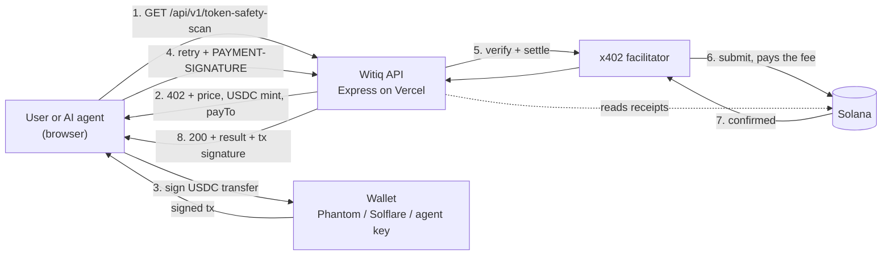
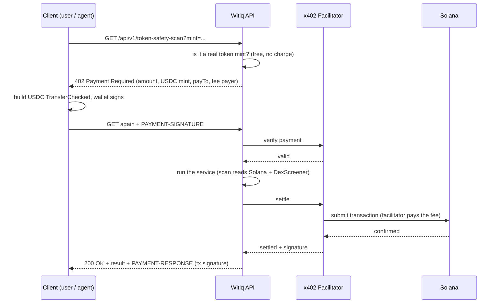

<div align="center">


# Witiq

### Know if a token is safe before you buy. Pay a cent, not a subscription.

**Witiq is a pay-per-request agent marketplace on Solana, powered by x402. Its first agent is a Token Safety Scanner: paste any Solana token address and get a 0 to 100 safety score with a reason for every check, for $0.01 in USDC. Humans and AI agents pay over plain HTTP. The payment *is* the access control. No accounts. No API keys. No subscriptions.**


**[Live demo](#-links)** · **[Demo video](#-links)** · **[Token Safety Scanner](#%EF%B8%8F-the-first-agent-token-safety-scanner)** · **[Payment proof](#-payment-proof-failure-next-to-success)** · **[Run it locally](#%EF%B8%8F-setup--run-locally)**

</div>

---

## 🔗 Links

| | |
|---|---|
| 🌐 **Live demo** (Solana mainnet) | **[ADD YOUR LIVE URL, e.g. https://witiq.vercel.app]** |
| 🎬 **Demo video** (2–4 min) | **[ADD YOUR VIDEO LINK]** |
| 🧾 **A real mainnet payment** | **[ADD ONE SOLANA EXPLORER TRANSACTION LINK]** |
| 🏆 **Track** | Best Use of x402 on Solana, Encode Club |

> **Judges, the fastest way to try it:** open the live demo → **Token Scanner** → tap **BONK** → **Connect wallet** → **Pay $0.01** → see the safety score and its public Solana receipt. Then open **Payment Proof** and press **Send forged payment**: HTTP 402, nothing delivered, balance unchanged. You need about $0.05 of USDC on Solana and no SOL.

---

## 💡 The problem

Every day thousands of new tokens launch on Solana, and many are built to trap buyers: the creator can still print supply, freeze your tokens so you can't sell, or holds most of it and dumps. Checking takes a block explorer, a DEX screener and know-how most buyers don't have, at the exact moment they're about to spend money.

The checks themselves are worth **about a cent each**. That's the second problem:

- **Cards can't charge a cent.** The fee is bigger than the price.
- **Subscriptions and API keys are heavy.** Nobody signs up and adds a card to check one token.
- **AI agents can't sign up at all.** A trading or wallet agent that wants to check a token before buying it can't fill in a form or enter a card.

## ✨ The solution

Witiq turns each check into a plain HTTPS endpoint with a **price per request**. The server answers **`402 Payment Required`** ([x402](https://x402.org)). The caller signs a tiny USDC transfer, **it settles on Solana mainnet**, and the result comes back in the same request.

```text
You (or your AI agent)  →  "scan token DezX…B263"
Witiq                 →  402 Payment Required: "0.01 USDC to this address"
You (or your agent)     →  sign a USDC transfer, retry
Solana                  →  the payment settles on-chain
Witiq                 →  200 OK + safety score + a public transaction receipt
```

### Why people come back

The judges asked for a use case people **return to**. A token check isn't a one-off demo call: it's needed **every time someone is about to buy a token**, which for an active Solana user is several times a week. Each time it's worth a cent, never a subscription, and an AI agent can pay for it with no human in the loop. That's the loop Witiq is built around:

1. **People** scan before they buy (Token Scanner page, recent scans saved on their device).
2. **Agents** buy the scan automatically as one step of a real task, e.g. "Before I buy this token, is it safe, what's the price doing, and is this airdrop link legit?" ([Agent mode](#-agent-mode-an-agent-that-completes-a-real-task)).
3. **Any outside AI tool** can discover and pay for the scanner through `/api/catalog` and `/llms.txt`, with no signup.

---

## 🛡️ The first agent: Token Safety Scanner

Paste a token mint address, get a **0 to 100 safety score**, a plain verdict (**Low risk / Caution / High risk**) and **one sentence per check**. Built as a clean API from day one, so the same scan is a paid endpoint, a page, and a tool for agents.

| # | Check | What it looks at | Source |
|---|---|---|---|
| 1 | **Mint authority** | Can someone still print new tokens? | Solana RPC (mint account) |
| 2 | **Freeze authority** | Can the developer freeze holders so they can't sell? | Solana RPC |
| 3 | **Hidden transfer rules** | Token-2022 permanent delegate, transfer fees, transfer hooks, default-frozen accounts, pausable, non-transferable | Solana RPC (mint extensions) |
| 4 | **Holder concentration** | Share held by the top 10 wallets. Liquidity pools, bonding curves and lockers (program-owned or off-curve owners) and the burn address are **excluded** | `getTokenLargestAccounts` + owner lookups |
| 5 | **Dev wallet** | How much the mint, freeze or metadata authority wallet still holds | Solana RPC |
| 6 | **Liquidity** | USD liquidity across all pools | DexScreener |
| 7 | **Age and trading** | Age of the first pool, 24h sell pressure, wash-trading signal (volume ≫ liquidity) | DexScreener |
| 8 | **Metadata** | Can the name/logo still be changed (Metaplex `isMutable` or Token-2022 metadata authority)? Are socials listed? | Solana RPC + DexScreener |
| 9 | **Bundled launch** | Linked wallets buying in the first block. **Not checked yet**, shown honestly as unknown | planned (Helius) |

**Scoring.** Each check has a weight. A warning costs half its weight, a fail costs all of it, and **unknown checks are left out instead of guessed** (the result shows a confidence level). An open mint authority, open freeze authority or a Token-2022 drain/freeze power caps the score at High risk on its own.

**Fairness rules.** It never calls anything a scam, it shows the reason behind every point, and it says when data is missing. Regulated stablecoins (USDC, USDT, PYUSD) keep their authorities by design, so those are shown as information rather than flagged as risk. Scores are information, not financial advice.

**Never charged for a bad request.** Before the paywall, the server checks that the address really is a token mint. A wallet address, a typo or a token account gets a clear error and **no payment request**. Results are cached for 5 minutes to save RPC credits.

---

## 🧾 Payment proof: failure next to success

x402 judges reward clear failure handling, so the app has a page built to show it: **Payment Proof**.

| | Forged payment | Cancelled in wallet | Real purchase |
|---|---|---|---|
| What is sent | A well-formed x402 payload whose transaction is random bytes | Nothing: you reject in Phantom | A USDC transfer your wallet signs |
| HTTP status | `402` | not sent | `200` |
| Result delivered | **No** | **No** | Yes: the safety score |
| USDC before → after (read from Solana) | unchanged | unchanged | down by exactly $0.01 |
| Solana transaction | none | none | public receipt, with a **Verify** link that checks it on-chain |

The page reads your USDC balance from the chain before and after each attempt and puts both side by side, so the claim "nothing delivered, nothing charged" is shown with real numbers rather than asserted. The **Simulate forged payment** button in every service dialog runs the same check.

Full failure table:

| Situation | What happens | Charged? |
|---|---|---|
| Invalid input (not a token mint, bad URL, broken request) | Rejected *before* the paywall with a clear error | No |
| Payment cancelled in the wallet | "You cancelled the request in your wallet" | No |
| Forged or invalid payment | Verification fails, `402` returned, nothing reaches Solana | No |
| Not enough USDC | Clear message with how to add USDC | No |
| Approval took too long (blockhash expired) | Asks the user to try again | No |
| Merchant payout account not activated | Plain-language notice, nothing sent | No |
| Settlement fails after the service ran | No result delivered | No |
| Upstream data provider down | Looked up *before* the paywall where possible; scanner checks that can't be read are marked unknown | No |
| Price above 0.05 USDC | Refused by the browser client and by the server at startup | No |

---

## 🧠 How Solana powers Witiq

> Solana is not a login button here. **It is the data source, the gate, the cash register and the receipt.** Remove Solana and the product stops working.

| # | Role of Solana | How it shows up in Witiq |
|---|---|---|
| 1 | **The data being judged.** | The scanner reads mint accounts, Token-2022 extensions, the largest token accounts and Metaplex metadata straight from Solana. |
| 2 | **Access control.** | A paid endpoint unlocks only when a USDC transfer is verified and settled on Solana mainnet. No user database, no session, no API key. |
| 3 | **Sub-cent economics.** | $0.003 to $0.01 per request is viable because Solana's base fee is a fraction of a cent. |
| 4 | **Fee abstraction.** | The x402 facilitator is the fee payer, so buyers need **only USDC**, no SOL. |
| 5 | **Fast, final settlement.** | The result comes back in the same HTTP request once the payment settles. |
| 6 | **Public, verifiable receipts.** | Every response carries the transaction signature. The **Verify** page and the **Developers** earnings page read it back from the chain, not from our database. |
| 7 | **Wallets for machines.** | An AI agent gets its own Solana keypair and spending caps with no signup. |
| 8 | **Non-custodial.** | Witiq never holds user funds or keys. Payments go straight to the merchant wallet. |

---

## 🚀 Try it in 2 minutes (mainnet, real USDC)

You need a Solana wallet with **about $0.05–$0.10 of USDC**. No SOL: the facilitator pays the network fee. Make sure the wallet is **not** in Testnet Mode.

1. Open the live demo → **Connect wallet**.
   - **Phone:** tap your wallet, approve in its app, and you come back to Safari connected.
   - **Desktop:** pick your wallet extension and approve.
2. **Token Scanner** → tap **BONK** (or paste any mint) → **Pay $0.01** → approve.
3. You get the score card and a **transaction link**. Tap **Verify** to have Witiq check that transaction on Solana.
4. **Payment Proof** → **Send forged payment** → HTTP 402, nothing delivered, balance unchanged.

### Watch an AI agent complete a real task

1. **Agent** → **Create agent wallet** (made in your browser; its key never leaves the device).
2. Send it about **0.10 USDC** from Phantom (Send → USDC → paste its address), then **Refresh balance**.
3. Pick **Before I buy a token** and press **Run agent**.

### See the paywall with `curl` (no wallet needed)

```bash
curl -i "https://<your-domain>/api/v1/token-safety-scan?mint=DezXAZ8z7PnrnRJjz3wXBoRgixCa6xjnB7YaB1pPB263"
# -> HTTP/1.1 402 Payment Required + a payment-required header (price, USDC mint, merchant, network)

curl -i "https://<your-domain>/api/v1/token-safety-scan?mint=notamint"
# -> HTTP/1.1 400 + "Enter a Solana token mint address", and no payment is ever requested
```

> Want to demo with test money instead? Deploy a second copy with `SOLANA_NETWORK=devnet` (see [Setup](#%EF%B8%8F-setup--run-locally)); everything switches to devnet USDC and the x402.org facilitator.

---

## 🤖 Agent mode: an agent that completes a real task

Machine-to-machine micro-purchases are exactly what cards and accounts can't do and **Solana plus x402 can**.

**Task:** *"I'm about to buy BONK (DezX…B263). Is the token safe, what is its price doing today, and is this claim link someone sent me legit? https://bonk-airdrop-claim.secure-verify.xyz/connect-wallet"*

1. **Plans.** It picks **Token Safety Scan** ($0.01), **URL Safety Scan** ($0.005) and **Data Snapshot** ($0.01). Planning uses Claude when `ANTHROPIC_API_KEY` is set, otherwise rules that spot token addresses, links and coin names. Every planned input is validated before use.
2. **Pays for each tool itself** from its own Solana wallet through the normal x402 flow: three real mainnet payments, no human approval per purchase.
3. **Stays under a cap.** The per-task cap (default $0.05) is enforced *before* buying, and no single request may exceed 0.05 USDC.
4. **Answers** in plain words (risk and facts, never buy or sell advice), with the score card and **a public Solana receipt for every purchase**. Total cost: $0.025.

---

## 🏗️ Architecture



### Payment sequence



### What the transaction contains

Built in `public/solana.js` with **no dependencies** and covered by unit tests. It matches what the x402 `exact` scheme verifies:

1. `ComputeBudget: setComputeUnitLimit`
2. `ComputeBudget: setComputeUnitPrice`
3. `SPL Token: TransferChecked` (buyer's USDC → merchant's USDC account)
4. `Memo` with a random nonce (makes every payment unique)

Signer slot 0 is the facilitator (fee payer, signs on settlement). Slot 1 is the buyer's wallet.

### On phones: Safari → wallet app → back

On mobile, wallet extensions don't exist in Safari, so Witiq uses the wallets' **universal-link protocol**. The page sends a connect or sign request to the wallet app, the user approves, and the wallet returns them to Safari with the answer. Requests and replies are **end-to-end encrypted** with a one-off key pair (NaCl box, bundled `tweetnacl`), so nothing sensitive travels in a URL. A payment waiting for approval is saved and finished automatically when the user returns. See `public/deeplink.js`.

---


## 🔒 Security and safety design

- **Non-custodial.** The server never holds user funds or keys. The merchant wallet is configured by **public address only**.
- **Spend limits.** No single request may exceed **0.05 USDC** (checked by the browser client, the agent and the server at startup). The agent also enforces a per-task cap.
- **Only the right token, only the right network.** The browser refuses to sign anything except a USDC transfer on the network the app is configured for.
- **No server wallet on mainnet.** The optional "Quick demo (no wallet)" buyer only ever runs on devnet. On mainnet it is switched off, because a server key with real USDC behind a public button could be drained.
- **Agent wallet = pocket money.** The agent's key is generated and stored in the browser and never sent anywhere. The UI tells users to fund it with cents.
- **Validate first, charge later.** Inputs are checked before the 402 is issued, with a per-IP limit on these free lookups.
- **Untrusted data stays data.** The scanner never fetches off-chain metadata URIs, and the agent's prompts treat tasks and results as data, not instructions.
- **Privacy.** Activity, analytics and recent scans live in the user's own browser. Nothing about the user is stored on the server.

---

## 📁 Project structure

```text
witiq/
├── api/index.js               Vercel serverless entry (wraps the Express app)
├── dev.js                     Local server (npm run dev)
├── src/
│   ├── app.js                 Express app: x402 paywall, free API routes, agent routes
│   ├── network.js             Mainnet / devnet settings (CAIP-2 id, USDC mint, RPC, facilitator)
│   ├── services.js            The five paid services + input validation
│   ├── tokenScan.js           Token Safety Scanner: one function per check, scoring, cache
│   ├── pda.js                 Dependency-free base58, ed25519 curve check, PDAs (metadata accounts)
│   ├── agent.js               Agent planner and report writer (Claude or rules)
│   ├── receipt.js             Turns a Solana transaction into a verifiable payment receipt
│   ├── solanaRpc.js           Balances, blockhash, token accounts, network stats, on-chain receipts
│   ├── market.js              Live market data (CoinGecko)
│   ├── summarize.js           AI summary (Claude or local fallback)
│   ├── demoBuyer.js           Devnet-only server-side demo buyer (x402 client)
│   ├── x402util.js            Reads x402 headers for display
│   └── errors.js
├── public/                    Front end: no build step, hash routing
│   ├── index.html, styles.css, app.js   (Token Scanner, Payment Proof, Agent, ... pages)
│   ├── netconfig.js           Network settings received from the server
│   ├── wallet.js              Wallet Standard connection (desktop / in-app browsers)
│   ├── deeplink.js            Phone flow: Safari → wallet app → back (encrypted)
│   ├── nacl.js                Bundled tweetnacl (public domain)
│   ├── solana.js              Dependency-free transaction builder and base58
│   ├── x402-browser.js        Pay-with-wallet x402 client + forged-payment proof
│   ├── agent-wallet.js        The agent's own browser wallet
│   └── llms.txt               Instructions for external AI agents
├── scripts/
│   ├── keygen.js              Generate devnet wallets
│   └── buyer.js               Command-line x402 buyer (devnet)
├── test/                      Automated tests
├── vercel.json
└── .env.example
```

---

## 🧰 Tech stack

| Layer | Technology |
|---|---|
| Payments | **x402 v2** (`@x402/core`, `@x402/express`, `@x402/fetch`, `@x402/svm`), `exact` scheme |
| Facilitator | **PayAI** on mainnet (settles and pays the fee), x402.org on devnet |
| Chain | **Solana mainnet**, USDC (SPL token), `@solana/kit` |
| Token data | Solana JSON-RPC (Helius recommended), DexScreener public API |
| Server | Node.js ≥ 20, Express, deployed as a Vercel serverless function |
| Front end | Vanilla ES modules, no framework, no build step |
| Wallets | Wallet Standard (Phantom, Solflare, Backpack) and universal links for phones |
| AI (optional) | Claude for agent planning, agent answers and AI Summary, with local fallbacks |

---

## ⚙️ Setup & run locally

### 1. Install

```bash
git clone <YOUR-REPO-URL>
cd witiq
npm install
```

### 2. Choose the wallet that gets paid

On **mainnet** you don't generate anything: use the **public address** of a wallet you control (e.g. your Phantom address). It must have held USDC at least once, which creates its USDC token account. If it never has, send it any amount of USDC first.

(For **devnet**, `npm run keygen` prints a disposable merchant and demo-buyer pair.)

### 3. Configure

```bash
cp .env.example .env
```

| Variable | Required | Purpose |
|---|---|---|
| `SOLANA_PAY_TO` | **Yes** | Public address that receives payments |
| `SOLANA_NETWORK` | No | `mainnet` (default) or `devnet` |
| `SOLANA_RPC_URL` | Recommended on mainnet | A dedicated RPC such as Helius (`https://mainnet.helius-rpc.com/?api-key=…`). The public RPC is rate limited and the scanner makes several calls per scan |
| `FACILITATOR_URL` | No | Defaults to `https://facilitator.payai.network` on mainnet and `https://x402.org/facilitator` on devnet |
| `ANTHROPIC_API_KEY` | No | Claude for agent planning, agent answers and AI Summary |
| `DEMO_BUYER_PRIVATE_KEY` | No, devnet only | Powers "Quick demo (no wallet)". Ignored on mainnet |
| `PORT` | No | Local port (default `4021`) |

### 4. Run

```bash
npm run dev      # open http://localhost:4021
```

Check `http://localhost:4021/api/health`: you want `"configured":true`, `"network":"mainnet"`, `"merchantAccount":true` and `"facilitator":true`.

### Deploy to Vercel

1. Push to GitHub (keep `api/`, `public/`, `src/` at the top level).
2. Import it in Vercel. No build command is needed.
3. Add the environment variables above (at least `SOLANA_PAY_TO`, and `SOLANA_RPC_URL` for mainnet).
4. **Redeploy** (variables apply to new deployments only).
5. Open `/api/health` and confirm the checks above.

**Facilitator costs.** PayAI covers a free allowance of mainnet settlements per receiving wallet without an API key. Past that it needs a PayAI API key, and each settlement costs a fraction of a cent. Check PayAI's pricing page for current numbers.

---

## ✅ Testing

```bash
npm test
```

Automated tests cover:

- the **Token Safety Scanner**: every check, scoring and the High-risk cap, pool exclusion, regulated-issuer handling, Token-2022 extensions, Metaplex metadata parsing, "unknown, never guessed" when the RPC or DexScreener is down, and rejection of wallets, token accounts and typos before payment;
- the dependency-free **address helpers** (base58, the ed25519 curve check, PDAs);
- **network settings** (mainnet default, devnet switch, valid mints, no secrets sent to the browser);
- the **agent planner** (a real pre-purchase task buys scan + link check + market data) and report writer;
- the **Solana transaction builder**, **receipt verifier**, **services**, the **encrypted phone-wallet** round trip, and the **API without configuration** (paid routes refuse and never charge).

---

## 🧭 Limitations (honest ones)

- **Real money.** On mainnet every request is a real USDC payment. Prices are 0.3 to 1 cent and capped at 5 cents.
- **The scanner is a signal, not a guarantee.** Exchanges' hot wallets count as ordinary holders; whether liquidity is locked or burned, the dev wallet's selling history and bundled launches are **not checked yet** and are shown as such. Market data comes from DexScreener's public API.
- **Public RPC limits.** Without a dedicated RPC, busy periods can make some checks come back "unknown" (the scan still completes, with lower confidence).
- **Facilitator dependency.** Settlement relies on PayAI's hosted facilitator.
- **Agent wallet has no withdraw yet.** USDC sent to it can be spent on Witiq tools, not moved out, so the UI tells users to fund it with cents.
- **Phone wallet flow** relies on the wallets' universal links. The Payment Proof page's real purchase needs the wallet inside the browser (desktop extension or Phantom's in-app browser).

## 🗺️ Roadmap

This is Phase 1 of the Witiq trust and agent platform plan:

- **Scanner, next:** dev-wallet selling history, liquidity lock/burn status and bundle detection with Helius; a public accuracy record from scanning known rugs and healthy tokens.
- **Phase 2, alerts:** watchlists with wallet sign-in, Helius webhooks and a Telegram bot for dev sells and liquidity pulls.
- **Phase 3, voice:** ask out loud whether a token is safe; read-only.
- **Phase 4+, the marketplace:** outside builders list their own agents with a price and get paid directly per request; agent reputation from on-chain receipts; agents hiring agents with owner-set spending limits; MCP so outside AI tools can hire them.

---

## 🎯 How Witiq maps to the judging criteria

| Criterion | Where to see it |
|---|---|
| Meaningful integration of **both x402 and Solana** | Every tool sits behind an x402 `402` paywall; every payment is a USDC transfer settled on **Solana mainnet**; the flagship tool reads its data from Solana too. |
| **Reliability of the payment-to-access flow** | Validate → 402 → sign → verify → settle → deliver. The **Payment Proof** page shows forged and cancelled payments next to a real one, with on-chain balances before and after. |
| **A compelling use case** beyond a basic demo | A **Token Safety Scanner** people need every time they buy a token, and an **agent that completes a real pre-purchase check** by paying for three tools itself. |
| **Clear documentation and sensible failure handling** | This README, the [failure table](#-payment-proof-failure-next-to-success), friendly in-app errors, and "unknown, never guessed" in every scan. |
| Working demo | [Live demo](#-links) on mainnet, and a devnet switch for test money. |
| 2–4 minute demo video | [Links](#-links). |

---

## 🙏 Acknowledgements

Built for the **Encode Club** Solana hackathon. Thanks to the [x402](https://x402.org) team, PayAI for the mainnet facilitator, the open-source Solana ecosystem, [tweetnacl-js](https://github.com/dchest/tweetnacl-js) (public domain), DexScreener and CoinGecko for public market data.

## 📄 License

MIT

<div align="center">

**Witiq: know before you buy. Pay only when you need it.**

</div>
